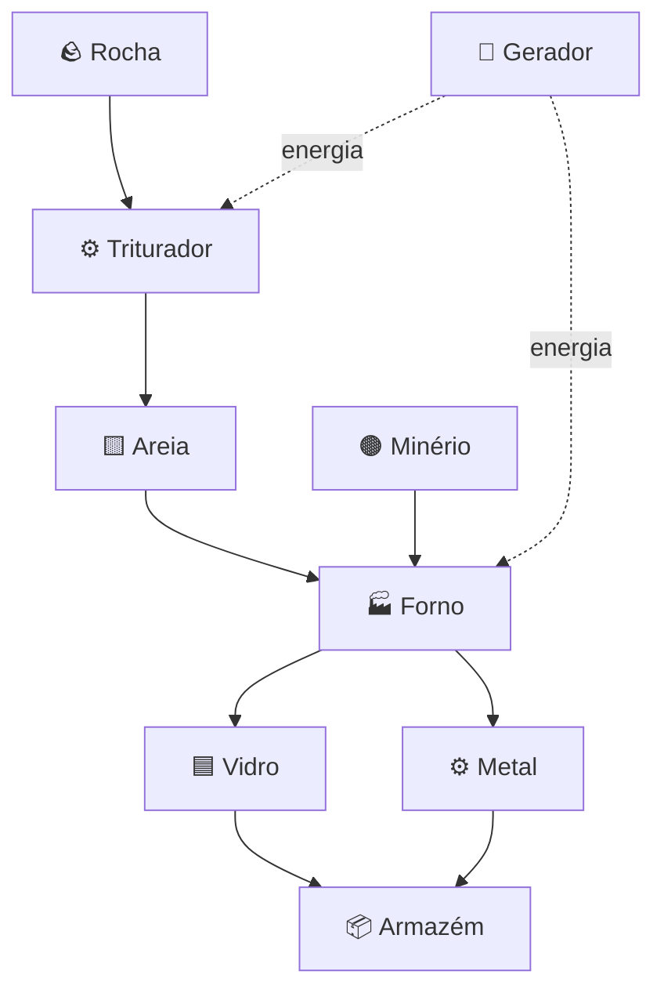

# [🏭 Fábrica de Areia](https://nik0lasdev.github.io/fabrica-de-areia/)

> **Sandbox industrial de física, materiais e automação** — construa sua própria fábrica, experimente reações e transforme recursos em produtos.

<p align="center">
  <a href="https://nik0lasdev.github.io/fabrica-de-areia/">
    
  </a>
  <a href="https://github.com/Nik0lasDev/fabrica-de-areia">
    
  </a>
</p>

<p align="center">
  
  
  
  
</p>

---

## ✨ Sobre o projeto

**Fábrica de Areia** é um pequeno sandbox jogável no navegador. Coloque materiais em um campo de partículas, instale máquinas e observe a fábrica funcionar. A interface foi pensada para desktop e telas menores, com controles por toque e mouse.

## 🎮 Recursos

| Recurso | O que faz |
| --- | --- |
| 🟨 **Areia e água** | Experimente materiais granulares e fluidos. |
| 🪨 **Rocha e madeira** | Use recursos sólidos e combustível. |
| 🔥 **Fogo e calor** | Queime madeira e aqueça a areia para criar vidro. |
| 🏭 **Forno** | Transforma areia em vidro e minério em metal, consumindo energia. |
| ⚙️ **Triturador** | Converte rocha em areia, usando energia. |
| ➡️ **Esteiras** | Transportam materiais entre células e podem mudar de direção. |
| 🔋 **Gerador** | Recupera energia para manter as máquinas funcionando. |
| 📦 **Armazém** | Guarda até **50 materiais** e permite retirar itens pela saída superior. |
| 💾 **Salvar e carregar** | Mantém o estado do campo e os inventários no armazenamento local do navegador. |

## 🏗️ Como funciona a fábrica



> As máquinas trabalham com os materiais próximos de acordo com as regras atuais da simulação. Posicionamento e espaço livre importam: deixe espaço para os itens se moverem e para retirar produtos dos armazéns.

## 🕹️ Comece a jogar

1. Abra **[Fábrica de Areia](https://nik0lasdev.github.io/fabrica-de-areia/)**.
2. Selecione um material na barra de ferramentas e arraste pelo campo para colocá-lo.
3. Escolha uma máquina e clique em uma célula para instalá-la.
4. Posicione areia ou minério acima de um forno para produzir vidro ou metal.
5. Use esteiras para experimentar o transporte de materiais.
6. Construa geradores para recuperar energia e armazéns para guardar produtos.
7. Use **Salvar** para guardar seu progresso neste navegador.

### 💡 Primeiro desafio

**Produza 10 unidades de vidro.** O jogo tem um objetivo inicial que concede um bônus de créditos quando a meta é alcançada.

## 📱 Controles

- **Mouse ou toque:** colocar materiais e máquinas.
- **Arrastar:** desenhar materiais pelo campo.
- **Esteira selecionada + toque na esteira:** girar a direção.
- **Pausar / Continuar:** controlar a simulação.
- **Passo:** avançar a simulação manualmente.
- **Salvar / Carregar:** gravar ou restaurar o estado local.
- **Reiniciar:** limpar o campo e começar novamente.

## 🧰 Tecnologias

- **HTML5 Canvas** para desenhar o campo.
- **CSS** para a interface responsiva.
- **JavaScript puro** para simulação, controles e máquinas.
- **LocalStorage** para salvar e carregar no navegador.

O protótipo é autocontido: a implementação principal está em `index.html`, sem etapa de compilação.

## 🚀 Executar localmente

1. Clone o repositório:
   ```bash
   git clone https://github.com/Nik0lasDev/fabrica-de-areia.git
   ```
2. Entre na pasta:
   ```bash
   cd fabrica-de-areia
   ```
3. Abra `index.html` no navegador. Para desenvolvimento, também pode usar a extensão **Live Server** no VS Code ou Cursor.

## 🗺️ Próximos passos

- [ ] Linhas de produção com alimentação e saída automatizadas.
- [ ] Receitas e máquinas adicionais.
- [ ] Melhorias visuais para identificar estados e inventários.
- [ ] Testes de desempenho e usabilidade em dispositivos móveis.
- [ ] Mais objetivos, progressão e balanceamento econômico.

## 🤝 Contribuições

Ideias, relatos de bugs e melhorias são bem-vindos. Abra uma **Issue** no GitHub com os passos para reproduzir o problema ou envie um Pull Request.

## 📄 Licença

Nenhuma licença foi declarada neste repositório até o momento. Consulte o proprietário antes de reutilizar ou redistribuir o código.

---

<p align="center">
  Feito para experimentar, construir e automatizar. <br>
  <a href="https://github.com/Nik0lasDev/fabrica-de-areia">⭐ Acompanhe o projeto no GitHub</a>
</p>
